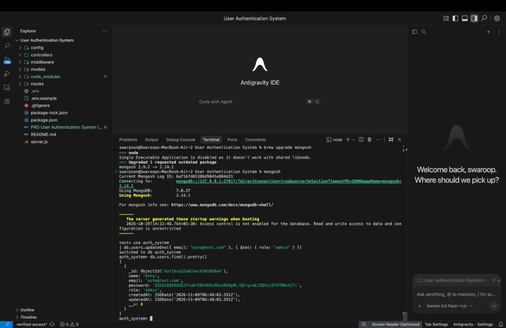
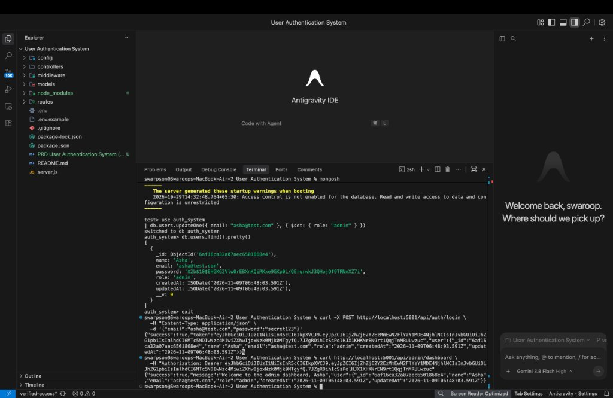
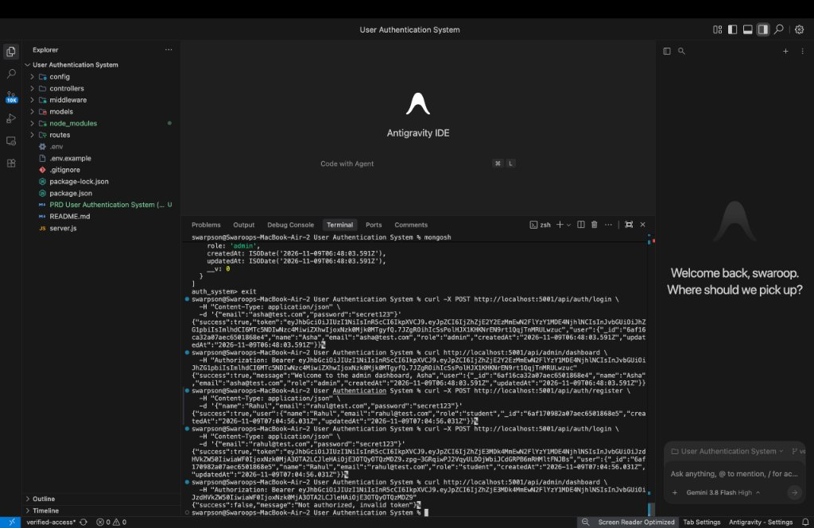

# User Authentication System (Express + MongoDB)

A secure, modular, production-grade RESTful authentication backend built with Node.js, Express, MongoDB (Mongoose), bcrypt, and JSON Web Tokens (JWT).

---

## 🚀 Features

- **User Registration (`POST /api/auth/register`)**:
  - Secure password hashing with `bcrypt` (10 salt rounds).
  - Enforces minimum 6 characters password length.
  - Automatic email lowercasing and trimming.
  - Unique email validation (returns `409 Conflict` on duplicates).
  - Default role assignment to `student`. Client input for `role` is strictly ignored to prevent privilege escalation.
  - Password and internal mongoose properties (`__v`) are never exposed in responses.

- **User Login (`POST /api/auth/login`)**:
  - Verifies credentials using `bcrypt.compare`.
  - Constant error message (`Invalid email or password`) for unknown emails and wrong passwords to prevent user enumeration.
  - Generates a signed JWT bearer token containing the user ID and role (`{ id, role }`).

- **Authentication Middleware (`protect`)**:
  - Validates `Authorization: Bearer <token>` header.
  - Verifies JWT validity and expiration.
  - Dynamically re-fetches the user document from MongoDB (excluding password) so role promotions or account revocations take effect immediately.

- **Role-Based Authorization Middleware (`authorize(...roles)`)**:
  - Restricts endpoint access by role (e.g. `student`, `admin`).
  - Returns `403 Forbidden` (`Forbidden: insufficient permissions`) if the user lacks the required role.

- **Protected Endpoints**:
  - `GET /api/users/profile` – Accessible to authenticated users.
  - `GET /api/admin/dashboard` – Restricted to `admin` role only.

- **Centralized Error Handling**:
  - Consistent error responses formatted as `{ "success": false, "message": "..." }`.
  - Handles Mongoose `ValidationError` (400), duplicate key error `code 11000` (409), and 404 route-not-found.
  - Prevents stack trace leakage in API responses.

---

## 📁 Project Structure

```
User Authentication System/
├── .env.example
├── .gitignore
├── package.json
├── server.js
├── README.md
├── PRD User Authentication System (Express + MongoDB).md
├── config/
│   └── db.js
├── models/
│   └── User.js
├── controllers/
│   ├── authController.js
│   └── userController.js
├── middleware/
│   ├── authMiddleware.js
│   └── errorMiddleware.js
├── routes/
│   ├── authRoutes.js
│   └── userRoutes.js
└── screenshots/
    ├── 01-mongodb-verification.jpg
    ├── 02-admin-login-dashboard.jpg
    └── 03-student-registration-login.jpg
```

---

## 🛠️ Prerequisites

- **Node.js**: v18.0.0 or later
- **MongoDB**: Local MongoDB instance running on port 27017 or a MongoDB Atlas connection string.

---

## ⚙️ Installation & Configuration

1. **Navigate to the project directory:**
   ```bash
   cd "User Authentication System"
   ```

2. **Install dependencies:**
   ```bash
   npm install
   ```

3. **Configure Environment Variables:**
   Copy `.env.example` to `.env`:
   ```bash
   cp .env.example .env
   ```

   Configure the values in `.env`:
   ```env
   PORT=5001
   MONGO_URI=mongodb://127.0.0.1:27017/auth_system
   JWT_SECRET=replace_with_a_long_random_string
   JWT_EXPIRES_IN=1d
   ```
   > **Note for macOS Users:** macOS Control Center / AirPlay Receiver uses port `5000` by default. Using port `5001` (configured in `.env`) avoids `EADDRINUSE` port conflicts.

   Generate a secure random secret key:
   ```bash
   node -e "console.log(require('crypto').randomBytes(48).toString('hex'))"
   ```

---

## 🍃 MongoDB Manual Steps & FAQ

### Do I need to manually create the database in MongoDB?
**No.** MongoDB creates databases and collections lazily on write:
- When the Express application connects and registers the first user (`POST /api/auth/register`), MongoDB **automatically creates** the `auth_system` database and the `users` collection.
- You do **not** need to execute any manual `CREATE DATABASE` SQL command.

### How to inspect the database manually in `mongosh`:
Open your terminal and run:
```bash
mongosh
use auth_system
db.users.find().pretty()
```

### How to promote a user to `admin`:
As per security requirements, the registration endpoint intentionally does not allow assigning the `admin` role from the client. To promote a user to admin:

1. Open MongoDB Shell:
   ```bash
   mongosh
   ```
2. Switch to the database and update the user:
   ```javascript
   use auth_system
   db.users.updateOne({ email: "asha@test.com" }, { $set: { role: "admin" } })
   ```
3. Log in again with `POST /api/auth/login` to receive a new JWT token containing the `admin` role.

---

## ▶️ Running the Application

### Production Mode:
```bash
npm start
```

### Development Mode (with hot-reload):
```bash
npm run dev
```

When started, you will see:
```
MongoDB connected: 127.0.0.1
Server on port 5001
```

---

## 📡 API Contract

| Method | Endpoint | Auth | Request Body | Success Response | Error Responses |
| :--- | :--- | :--- | :--- | :--- | :--- |
| `POST` | `/api/auth/register` | None | `{ name, email, password }` | `201` `{ success: true, user }` | `400` Validation error, `409` Duplicate email |
| `POST` | `/api/auth/login` | None | `{ email, password }` | `200` `{ success: true, token, user }` | `400` Missing fields, `401` Invalid credentials |
| `GET` | `/api/users/profile` | Bearer Token | None | `200` `{ success: true, user }` | `401` Token missing/invalid/expired |
| `GET` | `/api/admin/dashboard` | Bearer Token (`admin`) | None | `200` `{ success: true, message, user }` | `401` Unauthorized, `403` Insufficient permissions |

---

## 🧪 Testing Guide (cURL)

### 1. Register a new user:
```bash
curl -X POST http://localhost:5001/api/auth/register \
  -H "Content-Type: application/json" \
  -d '{"name":"Asha","email":"asha@test.com","password":"secret123"}'
```
**Response (201 Created):**
```json
{
  "success": true,
  "user": {
    "name": "Asha",
    "email": "asha@test.com",
    "role": "student",
    "_id": "...",
    "createdAt": "...",
    "updatedAt": "..."
  }
}
```

### 2. Login:
```bash
curl -X POST http://localhost:5001/api/auth/login \
  -H "Content-Type: application/json" \
  -d '{"email":"asha@test.com","password":"secret123"}'
```
**Response (200 OK):**
```json
{
  "success": true,
  "token": "eyJhbGciOi...",
  "user": { ... }
}
```

### 3. Access Profile (Protected):
```bash
curl http://localhost:5001/api/users/profile \
  -H "Authorization: Bearer <TOKEN>"
```

### 4. Access Admin Dashboard as a student:
```bash
curl http://localhost:5001/api/admin/dashboard \
  -H "Authorization: Bearer <TOKEN>"
```
**Response (403 Forbidden):**
```json
{
  "success": false,
  "message": "Forbidden: insufficient permissions"
}
```

### 5. Access Admin Dashboard after promotion:
After running `db.users.updateOne({ email: "asha@test.com" }, { $set: { role: "admin" } })` in `mongosh` and logging in again:
```bash
curl http://localhost:5001/api/admin/dashboard \
  -H "Authorization: Bearer <ADMIN_TOKEN>"
```
**Response (200 OK):**
```json
{
  "success": true,
  "message": "Welcome to the admin dashboard, Asha",
  "user": { ... }
}
```

---

## 📋 Test Matrix Verification

| # | Test Case | Status |
| :--- | :--- | :--- |
| 1 | Register valid user (201, no password leak) | ✅ Passed |
| 2 | Register duplicate email (409) | ✅ Passed |
| 3 | Register missing fields / password < 6 chars (400) | ✅ Passed |
| 4 | MongoDB password stored as bcrypt hash (`$2b$`) | ✅ Passed |
| 5 | Login with correct credentials (200 + JWT token) | ✅ Passed |
| 6 | Login wrong password / unknown email (unified 401) | ✅ Passed |
| 7 | Profile without token (401) | ✅ Passed |
| 8 | Profile with invalid / tampered token (401) | ✅ Passed |
| 9 | Profile with valid token (200 + user details) | ✅ Passed |
| 10 | Admin dashboard as student (403 Forbidden) | ✅ Passed |
| 11 | Admin dashboard as admin (200 OK) | ✅ Passed |

---

## 📸 Execution Screenshots

### 1. MongoDB Database Verification
Verification of user document stored with bcrypt hashed password and `admin` role in `mongosh`:


### 2. Admin Login & Dashboard Access (200 OK)
Logging in as admin with JWT token generation and successfully accessing `/api/admin/dashboard`:


### 3. Student Registration & Login Flow
Registering a new student (`POST /api/auth/register`), receiving default role `student`, and logging in:


---

## 📄 License

ISC
